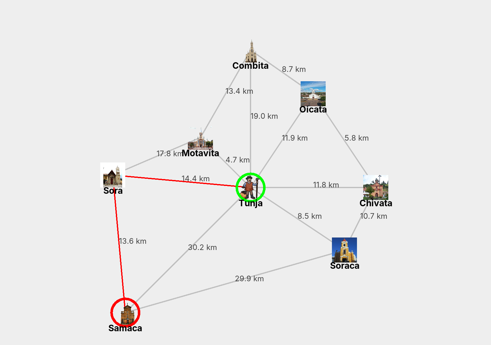

# Rutas más cortas entre municipios cercanos a Tunja

Aplicación de escritorio en Java (Swing) que encuentra la ruta más corta entre ocho municipios alrededor de Tunja con el algoritmo de Dijkstra. Proyecto de Matemáticas Discretas, UPTC.

## Cómo se usa
1. Haz clic en el municipio de origen (queda marcado en verde) y luego en el de destino (en rojo).
2. El mapa resalta en rojo la ruta más corta. Por ejemplo, de Tunja a Samacá la ruta más corta no es la vía directa (30,2 km) sino pasando por Sora (28 km).
3. Con la rueda del mouse acercas o alejas el mapa, y arrastrándolo lo mueves. Con el mapa bien acercado, un clic sobre un municipio lo abre en Google Maps.

Municipios: Tunja, Cómbita, Oicatá, Chivatá, Soracá, Samacá, Sora y Motavita.

## Cómo está hecho
- `model/MyGraphs.java`: el grafo (municipios y distancias en kilómetros) y el algoritmo de Dijkstra con cola de prioridad.
- `view/MyMap.java`: dibuja el mapa, maneja los clics, el zoom y el arrastre, y resalta la ruta.
- El código está separado en modelo, vista y presentador (paquetes `model`, `view` y `presenter`).

## Cómo correrlo
Necesitas Java 17 y Maven. En la raíz del repo:

    mvn compile
    java -cp target/classes co.edu.uptc.Main

También puedes abrirlo en IntelliJ o en VS Code y ejecutar la clase `co.edu.uptc.Main`.